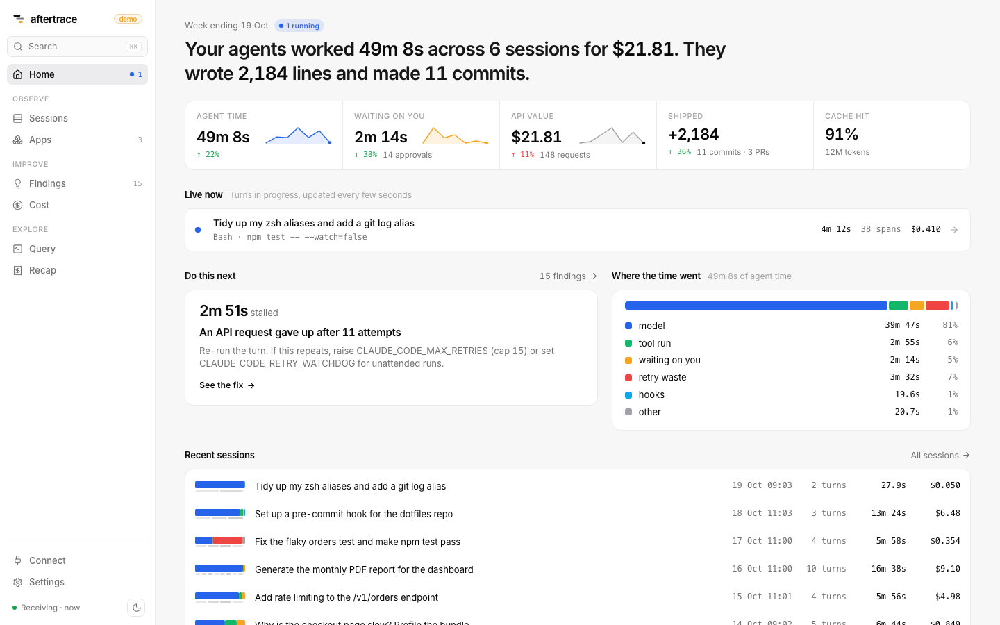

# Aftertrace

**The flight recorder for your AI work.** See what Claude Code, your agents and the apps you build with LLMs actually did: how long you waited, what it cost, and the one change worth making next.

One binary on your machine. Your data never leaves it.

[Website](https://rahulkraken.github.io/aftertrace/) · [Live demo](https://rahulkraken.github.io/aftertrace/demo/) · [Docs](https://rahulkraken.github.io/aftertrace/docs/install.html) · [Changelog](CHANGELOG.md)



It reads the OpenTelemetry that Claude Code (and any OTel-instrumented app) already exports, keeps it in a local DuckDB file, and turns it into findings like these, each linked to the spans behind it:

```
[high]   5 permission prompts for Bash(npm test:*), all approved
[high]   An API request gave up after 11 attempts
[medium] support-bot · POST /api/classify uses claude-opus-5-5 for 11-token answers
[medium] Cache hit rate fell from 98% to 0% after auto compaction
[medium] Hook PreToolUse:Bash averages 2.2s per run
```

## Install

```bash
curl -fsSL https://rahulkraken.github.io/aftertrace/install.sh | sh
aftertrace serve
```

Open http://127.0.0.1:7311 and go to **Connect**. macOS and Linux; Windows and building from source: [docs/install.md](docs/install.md). `aftertrace demo` loads synthetic sessions and apps if you want to look around first.

## Build from source

You need Go 1.24, a C compiler (DuckDB is linked with CGO), and Node 22. See [docs/install.md](docs/install.md).

```bash
cd web && npm ci && npm run build:embed && cd ..
go build -o aftertrace ./cmd/aftertrace
./aftertrace demo --db ./data/aftertrace.duckdb
./aftertrace serve --db ./data/aftertrace.duckdb
```

Open http://127.0.0.1:7311. `aftertrace demo` loads six synthetic Claude Code sessions and three synthetic apps that trigger every built-in rule, so you can look around before you connect anything. Demo records carry `aftertrace.synthetic=true`.

## Connect Claude Code

Add this to `~/.claude/settings.json` (Claude Code ignores these keys in a repository `.claude/settings.json`), then restart Claude Code:

```json
{
  "env": {
    "CLAUDE_CODE_ENABLE_TELEMETRY": "1",
    "CLAUDE_CODE_ENHANCED_TELEMETRY_BETA": "1",
    "OTEL_METRICS_EXPORTER": "otlp",
    "OTEL_LOGS_EXPORTER": "otlp",
    "OTEL_TRACES_EXPORTER": "otlp",
    "OTEL_EXPORTER_OTLP_PROTOCOL": "grpc",
    "OTEL_EXPORTER_OTLP_ENDPOINT": "http://127.0.0.1:4317",
    "OTEL_LOG_TOOL_DETAILS": "1"
  }
}
```

Run `aftertrace serve`. Your next turn shows up in the Sessions view.

- `OTEL_LOG_TOOL_DETAILS=1` gives real skill, MCP and Bash command names. It also records Bash commands and file paths. Aftertrace keeps those on your machine.
- To send over HTTP instead of gRPC, or to check that data is arriving, see [docs/claude-code-setup.md](docs/claude-code-setup.md).
- If you already run an OpenTelemetry Collector, see [docs/behind-a-collector.md](docs/behind-a-collector.md).

## What you get

**Home.** One sentence about your week, then agent time, time waiting on you, API value, what shipped and cache hit rate, each against last week. Live lanes show every turn still running across your sessions.

**Findings.** Each finding comes from a SQL rule over your local data. It has an impact in seconds or dollars, a recommendation you can act on, and evidence chips that open the waterfall on the span that triggered it.

| Rule | What it catches |
| - | - |
| `permission.allow_rule_candidate` | Prompts you always approve; suggests the allow rule |
| `retry.waste` | Time lost to API retries |
| `retry.exhausted` | Requests that gave up after retrying |
| `tool.repeated_errors` | The same tool failing again and again |
| `hook.overhead` | Slow hooks |
| `skill.cost` | Skills that drive a large share of spend |
| `mcp.large_results` | MCP tools that return large results |
| `cache.drop_after_compaction` | Cache hit rate collapsing after compaction |
| `model.switch_cache_rebuild` | A mid-session model switch that rebuilt the cache |
| `plugin.skills_unused` | Plugins whose skills load but never activate |
| `app.model_downgrade` | An app operation using a large model for short answers |
| `app.errors` | An app whose model calls fail often |
| `app.no_prompt_cache` | Large Anthropic prompts sent with no caching |

Details for each rule: [docs/findings.md](docs/findings.md).

**Trace.** One trace is one turn. Wall-clock time is split into model, tool run, waiting on you, retry waste, hooks and permission checks, and the critical path is highlighted. Click any span for its metrics, cost, input and output (when you opt into content), joined events and the findings that cite it. A turn opens as a transcript.

**Sessions.** One row per session, titled by your first prompt, with filters, search, agent time, waiting time and cost. Turns in progress appear while they run.

**Apps.** Your own services and agents sending OpenTelemetry GenAI spans (Claude SDK, Vercel AI SDK, Pydantic AI, OpenLLMetry, OpenInference): calls, cost, latency and failures per app and per operation. [docs/apps.md](docs/apps.md).

**Cost and Query.** Spend by source, model, skill, subagent, MCP server, tool and repo. A query builder and read-only SQL against the same store, and every result links back to its traces. **Ask** (opt-in, `aftertrace serve --ask`) answers plain-English questions with SQL written by Claude.

**Recap.** Your week as a short report and a receipt you can copy as an image: hours of agent work, what shipped, minutes waiting, API value against your plan.

## Private by default

- Binds to `127.0.0.1`. No telemetry, no update check, no phone-home.
- Prompt, response and tool content attributes are dropped at ingest unless you pass `--store-content`. Email, account and organization ids and the OS user name are always dropped.
- Ask is off by default. Turned on, it sends the question, the schema and query rows to the Anthropic API, nothing else.
- Everything lives in one DuckDB file, by default `~/.aftertrace/aftertrace.duckdb`. Delete it (and its `.wal`) to wipe your data.

More: [docs/privacy.md](docs/privacy.md).

## Write a rule

A rule is one SQL file that returns one row per finding. You write SQL, not Go:

```sql
-- @id hook.overhead
-- @title Slow hooks
-- @pillar bottleneck
SELECT 'medium' AS severity, 'Hook ... averages 2.2s per run' AS headline, ...
```

The format, the views you can query (`llm`, `tools`, `calls`, `turn_roots`, `q_spans`) and a worked example: [docs/writing-rules.md](docs/writing-rules.md). New rules are the most useful contribution you can make.

## How it works

```
Claude Code, your apps ── OTLP gRPC :4317 / HTTP :4318 ──▶ aftertrace ──▶ DuckDB (local file)
                                                    │
                                     SQL rules ─────┤
                                                    ▼
                                    UI + JSON API on 127.0.0.1:7311
```

One Go binary with DuckDB and the web UI embedded. It can also import an OpenTelemetry Collector's file-exporter JSONL (`aftertrace import`). Commands and flags: [docs/cli.md](docs/cli.md). JSON API: [docs/api.md](docs/api.md).

## Status

v0.1. Aftertrace is built and tested against Claude Code's documented telemetry and real sessions from Claude Code 2.1.x (version 2.1.0 or later, with the enhanced telemetry beta). Some of that telemetry is in beta and may change. Expect rough edges, and please [open an issue](https://github.com/RahulKraken/aftertrace/issues) when something looks wrong.

## Docs

[Install](docs/install.md) · [Claude Code setup](docs/claude-code-setup.md) · [Apps and agents](docs/apps.md) · [Behind a collector](docs/behind-a-collector.md) · [CLI](docs/cli.md) · [Findings](docs/findings.md) · [Writing rules](docs/writing-rules.md) · [JSON API](docs/api.md) · [Privacy](docs/privacy.md) · [Troubleshooting](docs/troubleshooting.md) · [Product brief](docs/product/brief.md) · [Contributing](CONTRIBUTING.md)

## License

[Apache-2.0](LICENSE).
