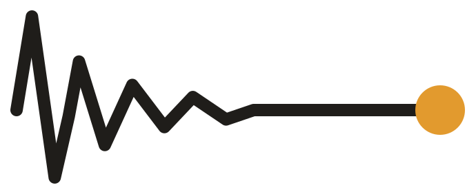
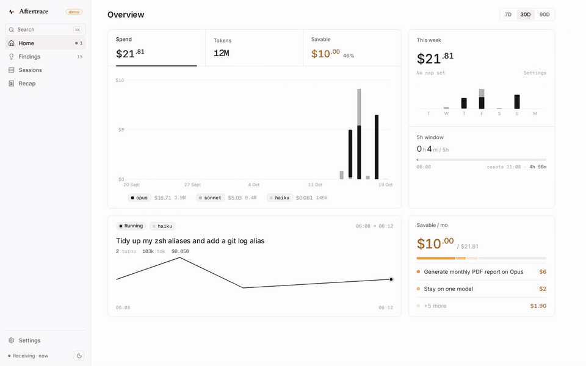

<picture>
  <source media="(prefers-color-scheme: dark)" srcset="docs/brand/mark-cream.svg">
  
</picture>

# Aftertrace

A local Mac app that watches your AI coding tools and tells you where the time and money went.

[](LICENSE)
[](https://github.com/RahulKraken/aftertrace/releases/latest)

[Website](https://rahulkraken.github.io/aftertrace/) · [Live demo](https://rahulkraken.github.io/aftertrace/demo/) · [Docs](https://rahulkraken.github.io/aftertrace/docs/how-it-works.html) · [Changelog](CHANGELOG.md)

<!--
  Native Mac extra is not in this GIF (this environment cannot capture NSMenu).
  Rahul: on a Mac, ~20s, light appearance:
    1. Click the Aftertrace extra (session identity, activity, tokens, $, Today, one finding)
    2. Open Aftertrace on Home
    3. Open Findings and the top finding
  Replace docs/images/demo.gif. Prefer `aftertrace demo` or a session you are happy to show.
-->


<sub>Recorded from Aftertrace's built-in demo fixtures, not a live user session. The Mac extra is a native menu and is not in this recording.</sub>

## Install

**Apple silicon.** v0.5.7 is signed and notarized.

**DMG:** [Aftertrace-mac-arm64.dmg](https://github.com/RahulKraken/aftertrace/releases/latest/download/Aftertrace-mac-arm64.dmg)

Open the disk image and drag Aftertrace to Applications.

**Homebrew:**

```bash
brew install --cask rahulkraken/tap/aftertrace
```

The app lives in the menu bar. Click the extra for live sessions, today's spend, and one finding. Opening the window makes it a normal Mac app; closing the window keeps the extra running. Start at login is off until you opt in.

**CLI** (macOS and Linux), for people who want the engine without the desktop shell:

```bash
curl -fsSL https://rahulkraken.github.io/aftertrace/install.sh | sh
```

That installs `aftertrace`, starts it at login, and opens http://127.0.0.1:7311. `aftertrace demo` loads synthetic sessions if you want to look around first. Building from source: [docs/install.md](docs/install.md).

## Supported tools

Aftertrace is an OpenTelemetry receiver on `127.0.0.1:4317` (gRPC) and `:4318` (HTTP). First-class views and findings are built around Claude Code spans. Anything else that speaks OTLP is stored; dedicated UI is not.

| Tool | Status |
| - | - |
| **Claude Code** | Supported. First launch imports `~/.claude/projects`. Live export is optional; snippet below. |
| **Claude Agent SDK** | Supported. Same telemetry as Claude Code; shows under Sessions. |
| **Your own apps** | Supported if they emit OpenTelemetry GenAI spans (Claude SDK, Vercel AI SDK, Pydantic AI, OpenLLMetry, OpenInference). |
| **OpenAI Codex CLI** | Partial. Connect snippet exists; data is stored and queryable. No dedicated views or Codex-specific findings. |
| **Gemini CLI** | Partial. Same as Codex. |
| **Cursor** | Not supported. No Connect snippet, no history import, no Cursor-specific ingest. Cursor's official OpenTelemetry export is Enterprise-only, remote HTTPS, and metrics/logs — it cannot target this local receiver. |

The supported download is the Apple-silicon Mac app. Windows and Linux desktop packages are attached to GitHub Releases as CI artifacts; they are untested.

## What it tells you

Each finding is a SQL rule over the local store. Fourteen ship today:

**Time.** Permission prompts you always approve. Time lost to API retries, and requests that gave up. The same tool failing again and again. Slow hooks.

**Cost.** Opus on tiny turns that never use a tool. An app operation using a large model for short answers. Cache hit rate collapsing after compaction, or a mid-session model switch that rebuilt the cache. Skills that drive a large share of spend. MCP tools that return huge results. Large Anthropic prompts sent with no caching.

**Usage.** Plugins whose skills load but never activate. An app whose model calls fail often (including `rate_limit_error` after it happens). Home also shows the current Claude Code 5-hour usage window when Aftertrace can see when it started — elapsed time in the window, not a forecast of an upcoming rate-limit hit.

Home, Sessions and Recap add live lanes, a wall-clock split (model, tools, waiting on you, retries, hooks), and spend in dollars. Rule ids and evidence: [docs/findings.md](docs/findings.md).

## Connect Claude Code

History is already in on first launch. To stream new turns live, add this to `~/.claude/settings.json` (Claude Code ignores these keys in a repository `.claude/settings.json`), then restart Claude Code:

```json
{
  "env": {
    "CLAUDE_CODE_ENABLE_TELEMETRY": "1",
    "CLAUDE_CODE_ENHANCED_TELEMETRY_BETA": "1",
    "OTEL_METRICS_EXPORTER": "otlp",
    "OTEL_LOGS_EXPORTER": "otlp",
    "OTEL_TRACES_EXPORTER": "otlp",
    "OTEL_EXPORTER_OTLP_PROTOCOL": "grpc",
    "OTEL_EXPORTER_OTLP_ENDPOINT": "http://127.0.0.1:4317",
    "OTEL_LOG_TOOL_DETAILS": "1"
  }
}
```

`OTEL_LOG_TOOL_DETAILS=1` keeps skill, MCP and Bash names real. It also records Bash commands and file paths. Aftertrace keeps those on your machine. HTTP instead of gRPC, or a collector in front: [docs/claude-code-setup.md](docs/claude-code-setup.md).

## Privacy

The engine never opens a network connection of its own. Your traces do not leave this machine.

- Binds to `127.0.0.1`. No usage telemetry, no crash reports.
- Prompt, response and tool content are dropped at ingest unless you pass `--store-content`. Email, account and organization ids and the OS user name are always dropped.
- The Mac app's update check talks only to GitHub Releases for the app package. It does not send traces or usage.
- Ask is off by default. Turned on, it sends the question, the schema and query rows to the Anthropic API, nothing else.
- The store is one DuckDB file, by default `~/.aftertrace/aftertrace.duckdb`. Delete it (and its `.wal`) to wipe your data.

More: [docs/privacy.md](docs/privacy.md).

## How it compares

[ccusage](https://ccusage.com/) and [CodeBurn](https://codeburn.app/) read local session files and give token and cost breakdowns with almost no setup. Aftertrace overlaps on cost, then adds a live view of time and friction — waiting on you, retries, slow hooks, cache rebuilds — and a finding you can act on. It needs an OpenTelemetry export (or Claude Code's local transcripts) instead of only reading each tool's on-disk logs. CodeBurn covers many more editors, including Cursor; Aftertrace does not.

## Status

v0.5.7. Built against Claude Code 2.1.x telemetry (enhanced telemetry beta). Some of that telemetry is in beta and may change.

[How it works](docs/how-it-works.md) · [Install](docs/install.md) · [Findings](docs/findings.md) · [Writing a rule](docs/writing-rules.md) · [Contributing](CONTRIBUTING.md) · [Support](SUPPORT.md)

## License

[Apache-2.0](LICENSE).
