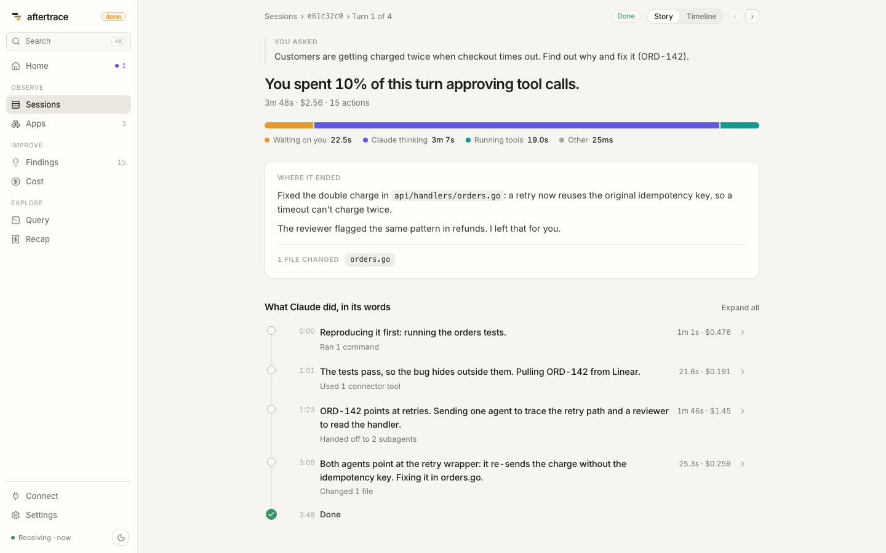

# Reading a turn

A turn is one prompt you type and everything Claude Code does until it answers. Aftertrace turns its spans into a timeline and gives every moment of the turn to exactly one thing: you, the model, a tool, or something else.

<!-- figure:turn -->


Point at a mark on the paper to read its span. Arrow keys step through the spans. Space pauses the recorder.

The turn in the figure is made up. It lasts 47.8 s: three model requests (the first one retried once), a `Grep`, and an `npm test` you had to approve.

## One turn is a tree of spans

Claude Code exports this tree when tracing is on (`CLAUDE_CODE_ENHANCED_TELEMETRY_BETA=1` and `OTEL_TRACES_EXPORTER=otlp`; see [Connect Claude Code](../claude-code-setup.md)):

```
claude_code.interaction                 one per prompt, the root of the trace
├── claude_code.llm_request             one per API request, retries included
│     span events: gen_ai.request.attempt, one per attempt
├── claude_code.tool                    one per tool call
│   ├── claude_code.tool.blocked_on_user   the permission prompt
│   └── claude_code.tool.execution         the tool running
└── claude_code.hook                    detailed beta tracing only
```

Children run one after another, mostly. A model request that ends in `tool_use` is followed by the tool calls it asked for, then the next request.

Claude Code sends the `claude_code.interaction` span only when the turn ends. Until then, Aftertrace treats the parent that the other spans point to as the root, and shows the turn as still running. The figure's grey pen draws a hairline while the turn runs. The bar fills in when the root arrives.

## What each span carries

| Span | Attributes Aftertrace reads | Needs a source flag |
|---|---|---|
| `claude_code.interaction` | `interaction.sequence`, `interaction.duration_ms`, `user_prompt_length` | `user_prompt` is `<REDACTED>` unless `OTEL_LOG_USER_PROMPTS=1`, and dropped at ingest unless `--store-content` |
| `claude_code.llm_request` | `model`, `effort`, `query_source_safe`, `agent_id`, `ttft_ms`, `input_tokens` (cache excluded), `output_tokens`, `cache_read_tokens`, `cache_creation_tokens`, `request_id`, `attempt`, `success`, `stop_reason`, `error_class` | none |
| `claude_code.tool` | `tool_name`, `result_tokens`, `bash_argv0`, `bash_command_class` | `full_command`, `file_path`, `skill_name`, `subagent_type` need `OTEL_LOG_TOOL_DETAILS=1` |
| `claude_code.tool.blocked_on_user` | `decision` (`accept`, `reject`, `cancelled`), `source` (`config`, `hook`, `user_temporary`, ...) | none |
| `claude_code.tool.execution` | `success`, `error`, `error_class` | none |

Some attributes need a minimum Claude Code version. [Schema notes](../schema-notes.md) has the full list.

## How events join the spans

Cost and decisions arrive as log events, not on the spans. Aftertrace joins them on ids:

| Event | Joined to | On | What it adds |
|---|---|---|---|
| `api_request` | `claude_code.llm_request` | `request_id` | `cost_usd` (Claude Code's own estimate), `query_source`, skill, agent, plugin and MCP names |
| `tool_decision` | `claude_code.tool.blocked_on_user` | the wait span's trace and span id, else `tool_use_id` | `decision` and `source` when the span says `unknown` |
| `tool_result` | `claude_code.tool` | `tool_use_id` | `success`, `tool_result_size_bytes`, tool input if content is stored |
| `user_prompt` | the turn | trace id, `prompt.id` | `prompt_length`, `command_name` |
| `assistant_response` | `claude_code.llm_request` | `request_id` | what Claude said, if content is stored |

Two views in [the store](store.md) do the joins that matter most. `llm` joins `api_request` to each request, and `tools` joins `tool_decision` to each tool call. Rules and the UI then read one row per request and one row per tool call.

## Where the time went: one owner per moment

Spans overlap. A tool span contains its wait and its execution, and the turn contains everything. Adding up span durations would count the same second more than once. So Aftertrace splits the turn's wall clock at every span start and end, and gives each slice to the most important thing running in it, in this order:

1. **Permission wait.** A `blocked_on_user` span that a person decided: a source starting with `user_`, or no source at all, so missing data never hides waiting.
2. **Retry.** A model request, from its start to its last `gen_ai.request.attempt`, when there was more than one attempt. A failed request counts as retry from start to end.
3. **Model.** The rest of each model request.
4. **Tool.** `claude_code.tool.execution`.
5. **Hook.** Hook spans, and the time in each `hook_execution_complete` event.
6. **Permission check.** A `blocked_on_user` span decided by config, a hook or the classifier. Nobody waited.

A slice with nothing running is **Other**. This is `Breakdown` in [`internal/analysis/analysis.go`](../../internal/analysis/analysis.go). In the figure it is the router at the left of the tally: it moves to the rod that owns the moment, and each whole second becomes a bead.

The story view's time bar folds those categories into four segments:

| Segment | Categories | The figure's turn |
|---|---|---|
| Waiting on you | permission wait | 17.8 s |
| Claude thinking | model, retry | 16.7 s |
| Running tools | tool | 11.85 s |
| Other | hook, permission check, gaps | 1.45 s |

The four always add up to the turn: 47.8 s here. The `Grep` permission was decided by config in 50 ms. It counts as Other, not as waiting on you.

The heading above the time bar comes from the same numbers. Aftertrace checks these in order and uses the first that applies:

- Questions Claude asked you (`AskUserQuestion`) held the turn for at least 8%, and they are most of the waiting: "Claude waited ... for your answer."
- Permission waits are at least 8%: "You spent 37% of this turn approving tool calls." This is the one the figure's turn gets.
- Retries are at least 8%.
- The model is at least 60%.
- Otherwise: the turn number and its length.

## The story view



The story view shows a turn as work, not as spans:

- **You asked.** Your prompt. Only stored if you opted in to prompt text and run with `--store-content`.
- **The headline and the time bar.** Described above.
- **The steps.** Steps are split by model requests and the tools that follow them.
  - If assistant responses are stored, each step is titled with the first line of what Claude said (`OTEL_LOG_ASSISTANT_RESPONSES=1` plus `--store-content`).
  - Without them, steps are grouped by what the tools did: explore, edit, run and so on.
  - Each step shows its time and cost.
- **Pauses.** A wait for a person of 60 s or more becomes its own item in the list, so a long approval reads as a pause in the story.

## The waterfall


The waterfall is the record the figure's paper draws: one row per span on a shared time axis.

- **Model rows.** A model request's bar is red up to its last attempt, lighter until the first token (`ttft_ms`), and solid after that.
- **Tool rows.** A tool's bar shows its permission wait in amber, then the run.
- **Fold waits.** This collapses long waits for you, so the work around them keeps its width.

Select a bar to see its attributes, its joined event and any findings that point at it.

## Reading where the time and money went

- **Waiting on you is high.** Look at the tool calls with an amber wait. If the same command keeps asking, the [`permission.allow_rule_candidate`](../findings.md) finding names the allow rule that would stop it.
- **Thinking is high.** Look at the model rows:
  - The lighter part of the bar is the wait for the first token (`ttft_ms`).
  - A long solid bar is output.
  - `cache_read_tokens` near zero after a `/compact` or a model switch means the prompt cache was rebuilt. Two findings cover this: `cache.drop_after_compaction` and `model.switch_cache_rebuild`.
- **Red at the start of a model row.** Retries. `retry.waste` adds them up across sessions.
- **Running tools is high.** Find the longest teal bars. Those are the commands and tools themselves: a slow test suite, a big search, a subagent.
- **Money.** Cost is per model request, from `api_request.cost_usd`. A step's cost is the sum of its requests. The turn's cost adds up every request in its trace.

Next: [Findings](findings.md) for how rules turn these rows into advice.
